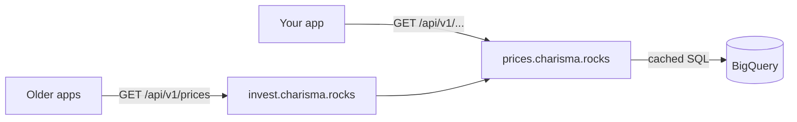
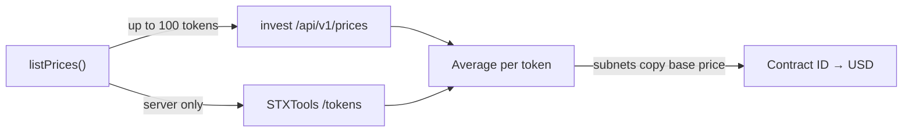

# Prices API

Read current and historical token prices over HTTP from [prices.charisma.rocks](https://prices.charisma.rocks), or through `@repo/tokens` inside the monorepo.



Public, no key, any origin. Base URL: `https://prices.charisma.rocks/api/v1`.

:::tip Building with an AI assistant?
[`https://prices.charisma.rocks/llms.txt`](https://prices.charisma.rocks/llms.txt) is this whole API as one prompt. Paste it into your assistant, or use the **Copy AI prompt** button on any token page.
:::

## `GET /prices`

Every priced token, sorted by liquidity.

| Query | Meaning |
|---|---|
| `tokens` | Optional. Comma-separated contract IDs to return only those. |
| `sparkline` | Optional. `1` adds `sparkline`: 42 USD closes over 7 days. |

```json
{
  "btcUsd": 81345.3,
  "updatedAt": "2026-10-16T18:40:34.494Z",
  "count": 93,
  "tokens": [
    {
      "contractId": ".stx",
      "symbol": "STX",
      "name": "Stacks Token",
      "image": "https://charisma.rocks/stx-logo.png",
      "decimals": 6,
      "usd": 0.395826,
      "sbtc": 0.000004866,
      "change": { "1h": -0.63, "24h": -2.12, "7d": 2.6, "30d": 69.6 },
      "liquidityUsd": 1578132,
      "roundTripLoss": 1.2,
      "thin": false,
      "updatedAt": "2026-10-16T18:40:34.494Z",
      "stale": false
    }
  ]
}
```

| Field | Meaning |
|---|---|
| `contractId` | `.stx` for STX, otherwise `<address>.<contract-name>`. Use it as the key. |
| `symbol`, `name`, `image`, `decimals` | From the Charisma token list. `image` can be missing. |
| `type`, `base` | `type: "SUBNET"` marks a Blaze subnet copy; it shares `base`'s price. |
| `usd`, `sbtc` | Price per whole token in dollars and in sBTC (× 100,000,000 for sats). |
| `change` | Percent change over `1h`, `24h`, `7d` and `30d`. `null` without enough history. |
| `liquidityUsd` | Dollar value of the token held in Charisma's pools. |
| `roundTripLoss` | Percent lost buying about $1 and selling it straight back. `null` for prices from before 16 October 2026. |
| `thin` | `roundTripLoss` over 25%: the price moves easily and is less reliable. |
| `updatedAt`, `stale` | When it was last priced; `stale` once that's over 15 minutes ago. |

## `GET /prices/{contractId}`

One token with the same fields, plus its `sparkline`. 404 with an `error` message if it has never been priced.

## `GET /prices/{contractId}/history`

Open, high, low and close per period, oldest first.

| Query | Meaning |
|---|---|
| `interval` | `5m`, `1h` (default), `4h`, `1d` or `1w`. 5m candles are the raw 5-minute prices, so open = high = low = close. |
| `quote` | `usd` (default) or `sbtc`. |
| `from`, `to` | Optional. ISO dates or Unix seconds. Defaults: the last day (5m), 7 days (1h), 30 days (4h) or everything (1d, 1w). |
| `limit` | 1 to 2000, default 500. The newest candles are kept. |

One request covers at most 7 days of 5m, 90 days of 1h or 365 days of 4h candles; past that it answers 400 with the limit in the message.

```json
{ "token": ".stx", "interval": "1d", "quote": "usd", "count": 289,
  "candles": [{ "time": 1767225600, "open": 0.6785, "high": 0.6835, "low": 0.6577, "close": 0.6626, "points": 288 }] }
```

`time` is the candle's start in Unix seconds, ready for TradingView's lightweight-charts.

## `GET /health`

`{ ok, lastRecordedAt, ageSeconds, tokensPriced }`. Answers 503 when the last recording is over 15 minutes old, so uptime monitors can watch it.

## Caching

Every answer is cached on the server and shared. Current prices refresh as soon as each 5-minute run lands, so polling faster than once a minute gains nothing. A history window that's wholly in the past never changes and is kept for a day. `from` and `to` snap to the candle grid (5 minutes for 5m, otherwise the hour), so near-identical requests share one answer.

## Invest: the older shape

`GET https://invest.charisma.rocks/api/v1/prices` (with `token`, `limit`, `minPrice`) and `/api/v1/prices/{contractId}` keep their original response shape for older apps, read from the prices API:

| Field | Meaning |
|---|---|
| `tokenId`, `symbol`, `name`, `decimals`, `image` | As above. |
| `usdPrice`, `sbtcRatio` | `usd` and `sbtc`. |
| `confidence` | `1 − roundTripLoss / 100`, or 1 for older prices. |
| `totalLiquidity` | `liquidityUsd`. |
| `lastUpdated` | `updatedAt` in Unix ms. |

New code should call prices.charisma.rocks directly.

## `@repo/tokens`

```ts
import { pricesClient, listPrices } from '@repo/tokens';

const { tokens } = await pricesClient.list({ sparkline: true });
const cha = await pricesClient.get('SP2ZNGJ85ENDY6QRHQ5P2D4FXKGZWCKTB2T0Z55KS.charisma-token');
const candles = await pricesClient.history('.stx', { interval: '1d', from: new Date('2026-01-01') });
```

| Method | Returns | On error |
|---|---|---|
| `pricesClient.list({ tokens?, sparkline? })` | `{ btcUsd, updatedAt, count, tokens: TokenPrice[] }` | Throws |
| `pricesClient.get(contractId)` | `TokenPrice` | Throws, including 404 |
| `pricesClient.history(contractId, { interval?, quote?, from?, to?, limit? })` | `PriceCandle[]` | Throws |

15-second timeout. It always calls production.

### `listPrices()`



- On the server it averages STXTools with the invest API. The browser skips STXTools, so server and browser can disagree.
- 5-second timeout per source. Returns `{}`, not an error, when every source fails.
- `listPricesInternal()` and `listPricesSTXTools()` use one source each.

## Gotchas

- All the [known limits](./overview.md#known-limits) apply: key on contract ID (two different tokens even share the symbol `B`), and check `thin` and `stale`.
- Prices before 16 October 2026 were stored to 9 decimal places, so the cheapest tokens' older `sbtc` history is rounded. Candles work out `sbtc` from `usd` and that run's BTC price instead.
- Until February 2026 history is hourly at best and covers about 11 tokens.
