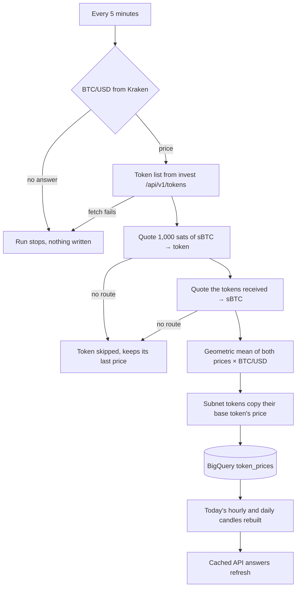

# How prices work

[Charisma Prices](https://prices.charisma.rocks) prices every token every 5 minutes by swapping a little sBTC into it and back out through the Charisma router. It keeps the full history and serves it through a [free API](./api-reference.md).

## The anchor

sBTC is priced at 1 BTC, and BTC/USD is Kraken's last trade price. Kraken is the only source. If it doesn't answer, the run stops and writes nothing, so prices go stale rather than wrong.

## Each run

| Step | Detail |
|---|---|
| Tokens | Every token in `https://invest.charisma.rocks/api/v1/tokens` except sBTC and subnet tokens. |
| Quotes | `https://swap.charisma.rocks/api/v1/quote`, 1,000 sats (0.00001 sBTC) in, 4 at a time. |
| Mid price | The buy price pays fees going in and the sell price pays them coming out. Their geometric mean cancels the fees. |
| Round-trip cost | How much value the buy-and-sell-back loses. 1–3% is a healthy pool. Over 25% marks the token `thin`, because its price moves easily. |
| Subnets | A subnet token (`type: SUBNET`) gets its base token's price, if the base priced in this run. |
| Storage | One row per token, all sharing one timestamp, with 38 decimal places so the cheapest tokens keep their real price. |

Source: [`apps/prices/src/lib/recorder.ts`](https://github.com/r0zar/charisma/blob/main/apps/prices/src/lib/recorder.ts).

## Candles and junk filtering

Charts and changes use candles: each hour's and each day's open, high, low and close. A raw price is left out of candles when it's more than 3x away from its token's hourly median or 10x away from its daily median. Prices from the older pricing method (before February 2026) must sit within 2x of their daily median. The raw history itself is never changed.

History starts on 29 July 2025. Until February 2026 only about 11 tokens were priced, roughly once an hour.

## Routes

The router (`dexterity-sdk`) searches paths of up to 4 hops through Charisma pools and wrapped external pools from Bitflow, ALEX, Arkadiko and Velar. A trade in or out of a Blaze subnet gets one extra step for the 1:1 wrap. Bitflow DLMM (bin) pools and stableswaps don't reveal a price from their reserves, so the router probes each with a tiny live quote (`withSpotPrices`) to rank routes. The top-ranked routes are then quoted on-chain, and the best output wins.

Stablecoins get no special treatment. There is no $1 override: a stablecoin is worth whatever its route says.

## Known limits

| Limit | Example | What to do |
|---|---|---|
| Thin routes misprice. A price is only as good as the pools on its best route. | xBTC has read over $108,000 (1.27 sBTC) through a route ending in a small Arkadiko pool, and USDA has read $1.49. | Check `thin` and `roundTripLoss`. Bitcoin wrappers should sit near 1 sBTC; stablecoins near $1. |
| A token with no route keeps its last price. | A token whose pools dry up stops updating. | Check `stale` (no price in 15 minutes) or `updatedAt`. |
| Subnet duplicates share a symbol. | Two `sBTC` entries: `SM3VDXK3WZZSA84XXFKAFAF15NNZX32CTSG82JFQ4.sbtc-token` and its subnet `SP2ZNGJ85ENDY6QRHQ5P2D4FXKGZWCKTB2T0Z55KS.sbtc-token-subnet-v2`. | Key on contract ID, never symbol. |

See [Prices API](./api-reference.md) for endpoints and fields.
