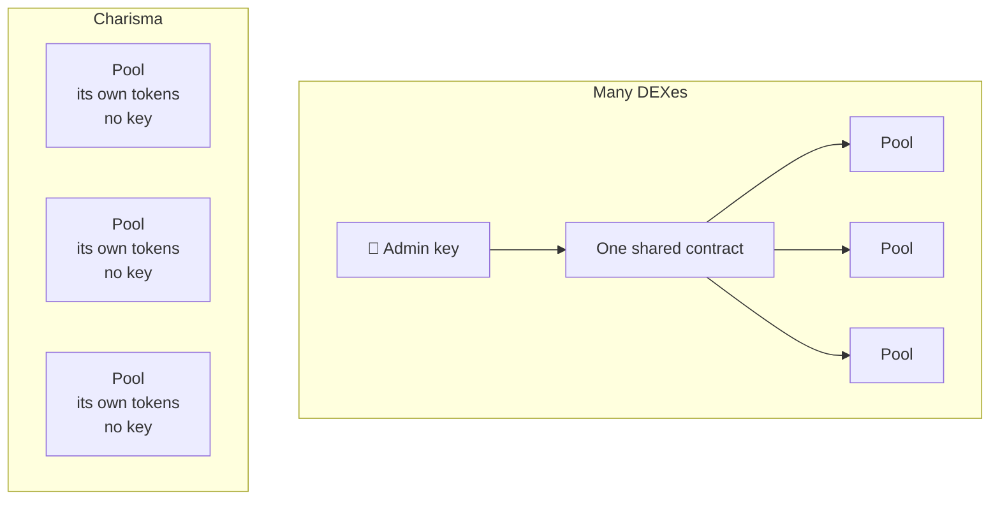
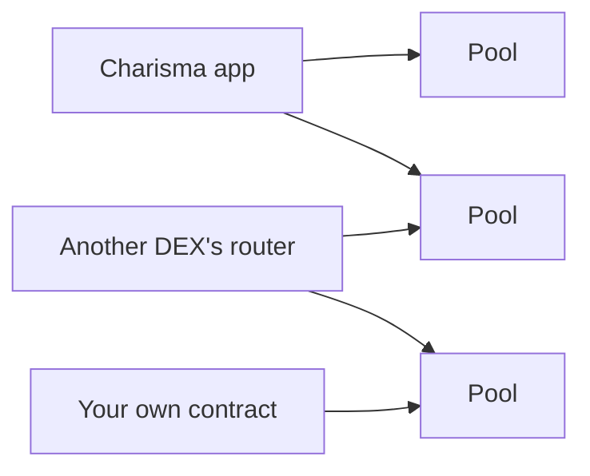

# Is it safe to trade through Charisma pools?

**Yes.** Every Charisma pool is its own small contract. Nobody, not even Charisma, holds a key that can pause it, change it or take from it. And because contracts on Stacks can never be edited, that will always be true.

## Every pool stands alone

Many DEXes run every pool from one shared contract, with admin keys that can change it. One mistake or one stolen key can touch everything.

Charisma doesn't work that way. Each pool is a separate contract that holds only its own two tokens.



## Why it's safe

| | Protection | What it means |
|---|---|---|
| 🧱 | **Every pool stands alone** | A pool holds only its own two tokens. A problem in one pool can't reach any other |
| 🔑 | **No master key** | No one can pause a pool, change its fee or withdraw from it. The only thing a pool's creator can change is its name and picture |
| 🔒 | **Nothing can change later** | A pool's code is locked the moment it goes live. New contracts can't change old ones |
| 🚪 | **Just in and out** | A swap does one thing: your tokens go in, the other token comes out. If it can't finish, nothing moves |
| 🎯 | **What it quotes is what it pays** | A Charisma pool works out the quote and the swap with the same math |
| 👀 | **Open for anyone to read** | Every pool's code is public on-chain, and it's short |

## Permanently secure, by design

These protections aren't promises or settings. They're how the pools are built.

There is no admin to make a bad call later, no upgrade that could slip in a change, and no key to lose or steal. So no future mistake, by Charisma or anyone else, can make a pool less safe than it is today.

**The security you get today is the security you'll always get.**

## One simple shape for every pool

Every Charisma pool speaks the same language, called **Dexterity**. Charisma proposed it as a Stacks standard in December 2024 ([SIP draft #204](https://github.com/stacksgov/sips/pull/204)).

It gives every pool the same two buttons:

| Button | What it does |
|---|---|
| `quote` | "What would I get?" Answers without changing anything |
| `execute` | "Do it." Runs the swap |

Because every pool has the same two buttons, any app or router, Charisma's or anyone else's, can connect to any pool. No special code, and no permission needed.



## What we checked

On 23 Oct 2026 we read the live code of all 155 pools on Charisma's list. Not one has a way to withdraw other people's tokens, pause trading or change its fee.

Before listing a new pool, Charisma tests it on a copy of mainnet to prove that what it quotes is exactly what it pays.

## What this doesn't cover

| Risk | What to know |
|---|---|
| 📉 **Prices move** | A pool can't stop the market moving. Set a minimum amount you'll accept on every swap |
| 🪙 **Tokens are their own thing** | A pool is only as good as the two tokens in it. Charisma can't vouch for every token |
| 🔗 **Pools from other DEXes** | Charisma also lists pools from Bitflow, ALEX, Velar and others. Those follow their own DEX's rules |

## Trading on the Charisma app?

On [swap.charisma.rocks](https://swap.charisma.rocks), a swap can hop through several pools in one go, using Charisma's multi-hop router. The router never holds your tokens: each pool trades with your wallet directly, and your wallet shows the most you'll send and the least you'll get before you sign. If any hop falls short, the whole swap is undone.

[How the routers work](./dexterity/overview.md#why-one-interface) has the details.

<details>
<summary>For developers</summary>

The interface every pool implements, `SP2ZNGJ85ENDY6QRHQ5P2D4FXKGZWCKTB2T0Z55KS.dexterity-traits-v0`:

```clarity
(define-trait liquidity-pool-trait
  (
    (execute
      (uint (optional (buff 16)))
      (response (tuple (dx uint) (dy uint) (dk uint)) uint))
    (quote
      (uint (optional (buff 16)))
      (response (tuple (dx uint) (dy uint) (dk uint)) uint))
  )
)
```

- **Swaps.** `execute(amount, 0x00)` swaps token A for B, and `0x01` swaps B for A. `dy` is the amount out. See [The opcode](./dexterity/opcodes.md).
- **No custody.** The pool takes the input from `tx-sender` and pays the output to `tx-sender`. Nothing passes through a third contract.
- **Exact quotes.** In the [pool template](https://launchpad.charisma.rocks/templates/liquidity-pool), `execute` pays out the result of the same read-only function `quote` returns, on the pool's real token balances.
- **Payout limits.** Pools built from the Clarity 4 template name the exact token and amount each payout may send (`as-contract?`). Anything else aborts.
- **The list.** Every listed pool is served by the [Invest API](./data-apis/invest-api.md#get-vaults). [Vault kinds](./dexterity/vault-kinds.md) covers each kind.

</details>
